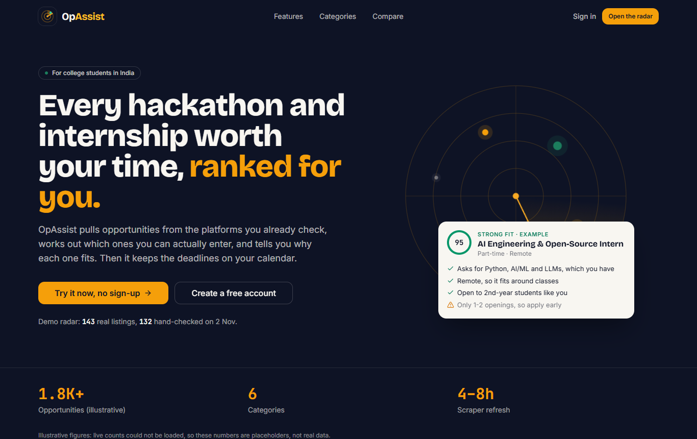
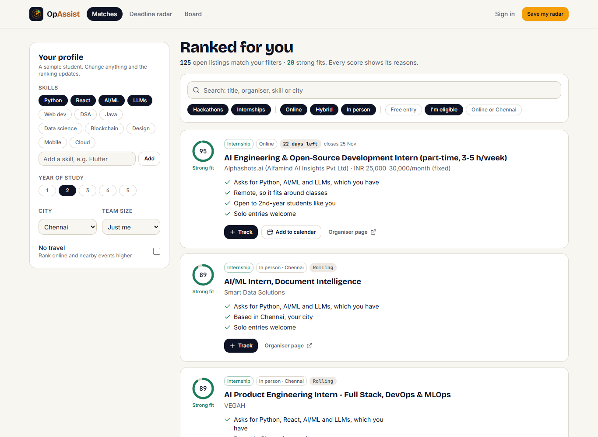
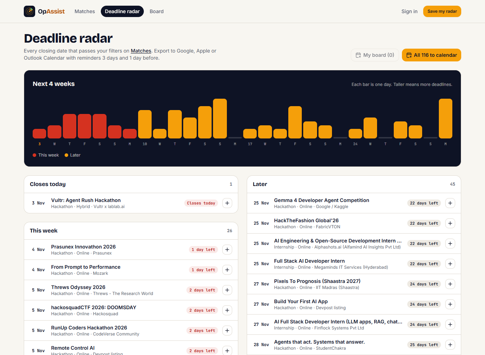
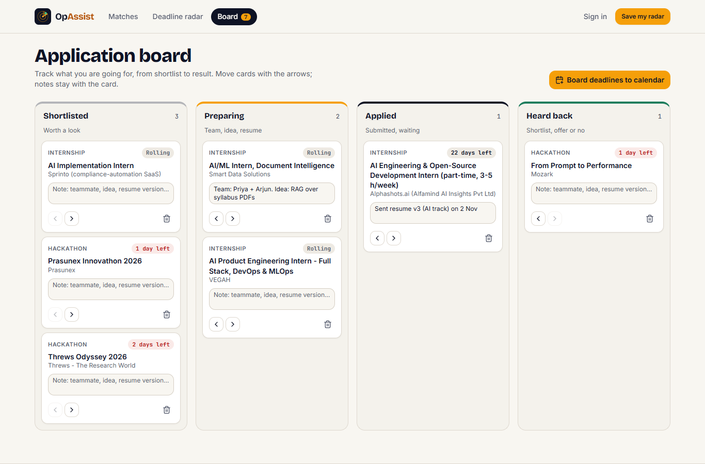
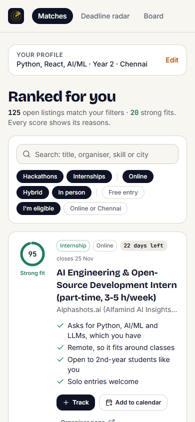
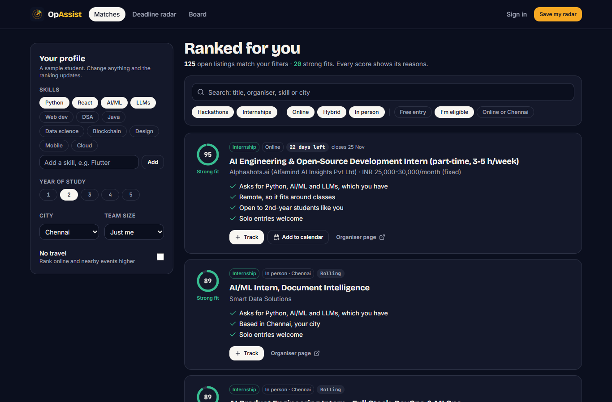

<p align="center">
  
</p>

<h1 align="center">OpAssist</h1>

<p align="center">
  <strong>The opportunity radar for Indian college students.</strong><br>
  It finds the hackathons and internships you can actually enter, says why each one fits, and keeps the deadlines on your calendar.
</p>

<p align="center">
  
  
  
  
  
</p>

<p align="center"></p>

## Why

Hackathons are on Devfolio, Unstop, Devpost and fest sites. Internships are on Internshala, LinkedIn and career pages. None of these sites knows you're a 2nd-year Python student in Chennai who works solo. You find out you're ineligible after reading the rules, and the deadline you meant to remember passes on a Tuesday.

OpAssist sits on top of those platforms. It gathers the listings, checks whether you can enter, explains the fit in plain language, and puts every closing date on one calendar. You still apply on the organiser's page. The full product brief, including an honest comparison with Unstop, Devfolio, Internshala and LinkedIn, is in **[docs/PRODUCT.md](docs/PRODUCT.md)**.

## What it does

### Matches that explain themselves
Set your skills, year, city and team size. Every listing gets a score from 0 to 100, and each score shows its reasons: *"Asks for Python, AI/ML and LLMs, which you have"*, *"Remote, so it fits around classes"*, *"Open to 2nd-year students like you"*. Blockers appear as cautions, never silently.



### Eligibility filters, on by default
Filter by hackathon or internship, online, hybrid or in person, free entry, *I'm eligible* (year of study, team size, audience), and *online or my city*. Listings you can't enter are hidden until you ask to see them.

### Deadline radar and calendar export
See the next four weeks of closing dates as a strip, grouped into today, this week, next two weeks, later and rolling. Export everything, or just your board, as an `.ics` file with reminders 3 days and 1 day before. It works with Google, Apple and Outlook calendars, with no account linking.



### One board for every application
Shortlisted, Preparing, Applied, Heard back. Hackathons and internships sit side by side. Each card keeps a note (teammate, idea, which resume you sent), and arrow buttons move cards, so the board is fully keyboard-accessible.



| Mobile | Dark mode |
|---|---|
|  |  |

**No sign-up needed.** The Radar runs entirely in your browser, and your profile and board stay in localStorage. Signing in unlocks the full scraped feed, bookmarks, server-side application tracking, team finder, campus leaderboard and notifications.

## Try it in two minutes

```bash
cd frontend
npm ci
npm run build && npm start      # http://localhost:3000/radar
```

You need no backend, database or Firebase keys for the landing page and the Radar. A walkthrough script is in **[DEMO.md](DEMO.md)**.

### Demo data
`frontend/data/seed-opportunities.json` holds **143 real listings** (120 hackathons and 23 internships), each hand-checked on **2 Nov 2026** against the organiser's page or the platform's public listing API. Only public listing fields are kept. Deadlines change, so the app tells users to confirm on the organiser's page. To regenerate the file from a newer research run:

```bash
node frontend/scripts/snapshot-seed.mjs <dir-with-hackathons.json-and-internships.json> 2026-11-02
```

## Full stack

```
frontend/   Next.js 16 · React 19 · TypeScript · Tailwind · Zustand
  app/radar/            public Radar: matches, deadlines, board
  lib/radar/            normalise · match · filters · deadline · ics · board  (pure, unit-tested)
  components/radar/     Radar UI
  app/(dashboard)/      signed-in app: feed, bookmarks, applications, calendar, team finder…
backend/    FastAPI · Supabase · APScheduler · 40+ source scrapers (API-first, DOM fallback)
extension/  Chrome MV3: one-click save from Devfolio, Unstop, HackerEarth
supabase/   SQL migrations, RLS policies, indexes
```

### Run everything

1. **Database.** Create a Supabase project and run `supabase/setup.sql` (or the files in `supabase/migrations/` in order).
2. **Backend.**
   ```bash
   cd backend && cp .env.example .env    # fill in Supabase + Firebase Admin
   pip install -r requirements.txt && playwright install chromium
   uvicorn main:app --reload             # http://localhost:8000
   ```
3. **Frontend.**
   ```bash
   cd frontend && cp .env.example .env.local   # Firebase web config + API URL
   npm ci && npm run dev                              # http://localhost:3000
   ```
4. **Extension.** Open `chrome://extensions`, turn on Developer mode, choose **Load unpacked** and select `extension/`.

### Environment

Only the example files are committed: [`.env.example`](.env.example), [`backend/.env.example`](backend/.env.example) and [`frontend/.env.example`](frontend/.env.example).

| Variable | Needed for | Required |
|---|---|---|
| `NEXT_PUBLIC_FIREBASE_*` | Sign-in on the web app | Only for accounts. Without them the build still passes and the public pages work; sign-in shows "not configured". |
| `NEXT_PUBLIC_API_URL` | The web app calling the API | Defaults to `http://localhost:8000`. |
| `SUPABASE_URL`, `SUPABASE_ANON_KEY`, `SUPABASE_SERVICE_KEY` | Backend database | Yes, for the backend. |
| `FIREBASE_*` (Admin SDK) | Backend token verification | Yes, for the backend. |
| `GROQ_API_KEY`, `ANTHROPIC_API_KEY` | AI match endpoints | Optional. |
| `CORS_ORIGINS`, `SCRAPE_INTERVAL_HOURS`, `ALLOW_DEV_AUTH` | Backend tuning | Optional. |

### API

| Route | Methods | Description |
|---|---|---|
| `/api/opportunities` | GET, POST | Browse and save opportunities |
| `/api/opportunities/stats` | GET | Public per-type counts (60 s cache) |
| `/api/opportunities/{id}/match` | POST | AI match score |
| `/api/profile` | GET, PUT | Profile |
| `/api/bookmarks` | GET, POST, DELETE | Bookmarks |
| `/api/applications` | GET, POST, PUT, DELETE | Application pipeline |
| `/api/notifications` | GET, PUT | Notifications |
| `/api/communities/leaderboard`, `/team-find` | GET, POST | Campus ranking, teammates |
| `/api/scrape/trigger` | POST | Manual scrape |
| `/api/ai/match`, `/recommend`, `/analyze` | POST | AI helpers |

### Quality

```bash
cd frontend && npm test && npm run typecheck && npm run lint && npm run build   # 177 tests
cd backend  && python -m pytest -q                                              # 186 tests, offline
```

The Radar pages, the landing page and login were checked with axe-core 4.10 at 1366px and 390px, in both light and dark mode. Axe reported 0 violations.

## Contributing

Branch from `main` (`feature/<name>` or `fix/<name>`), keep tests green, and open a pull request.

## License

MIT. A `LICENSE` file still needs to be added to the repository.
